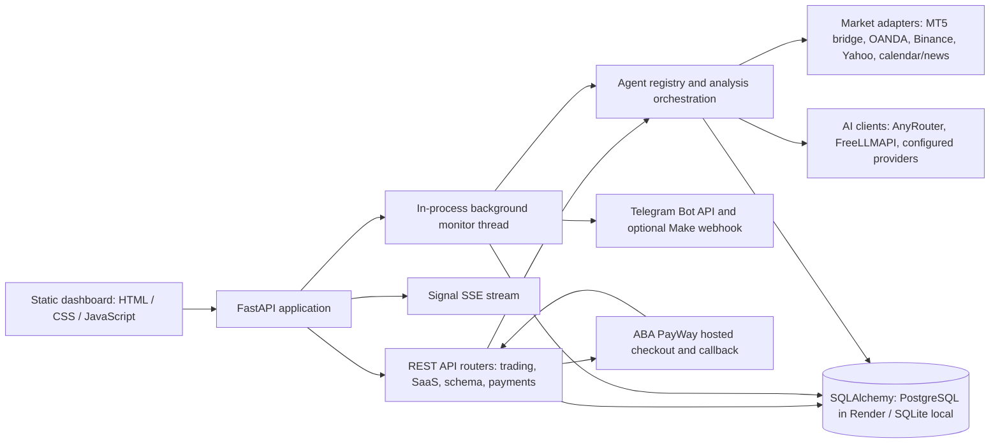

# ZYROX AI V2 — Phase 0 Architecture Audit

**Audit date:** 2026-10-31
**Source of truth:** the checked-out GitHub repository on branch `main` at `d6b7eff`
**Scope:** repository structure, runtime entrypoint, API routes, UI, agents, market data, persistence, auth, Telegram, payments, deployment configuration, and existing tests.
**Change policy:** this audit made no production-code changes and did not read or print live secret values.

**Implementation update (2026-10-31):** after the baseline audit, local changes added admin authorization and read-only/database-environment safety to Schema Studio, updated the billing page to show ABA environment/readiness and route unauthenticated checkout users through sign-in, and added focused regression coverage. Focused tests pass (21 passed, 2 deprecation warnings). The Render revision and production database were not changed; staging review remains pending.

## Executive summary

The project is an existing FastAPI trading and research application, not a blank demo. It already has a sizeable static dashboard, a Python analysis and signal stack, broker/feed adapters, Telegram notifications, SaaS accounts and entitlements, paper trading, backtesting, and an ABA PayWay adapter. Production is configured as one Docker web service on Render with managed PostgreSQL.

The V2 prompt is substantially broader than the current implementation. The repository has 17 registered agent adapters, but most use deterministic local Python logic; this does not mean 17 independent LLM agents are called for every scan. The frontend is plain HTML/CSS/JavaScript; the API exposes REST and Server-Sent Events (SSE), with no WebSocket implementation found. The requested full journal, model-training pipeline, PWA, and many V2 pages are not yet present as complete, independently verified capabilities.

**Baseline release blocker:** the Schema Studio API was mounted without authentication dependencies. Its SQL endpoint accepted a caller-controlled `read_only` flag, and its migration endpoint accepted a caller-controlled `environment` value. The local Phase 0.1 changes address these issues, but the deployed service remains on the previous revision until staging verification and an approved release.

The full baseline suite collected 301 tests and completed with **269 passed, 32 failed, 35 warnings** in 141.62 seconds. Failures are distributed across risk gating, paper trading, agent expectations, Telegram lifecycle policy, VIP response schemas, chart metadata, and MT5 test configuration. The failures need classification and repair; a green baseline is not established.

## Verified architecture

### Runtime and deployment

- Production entrypoint is `uvicorn taikry.api.app:app`; Docker uses Python 3.12, runs as an unprivileged user, and checks `/ping`.
- FastAPI mounts static files from `taikry/web` at `/dashboard`; the UI is not compiled from a frontend framework.
- `taikry/api/app.py` initializes the database at startup and can start `market_monitor_247` in a background thread when `AUTO_START_MONITORING` is enabled. Render declares one web instance and one managed PostgreSQL database.
- `taikry/database/session.py` also calls `init_db()` at import time. The FastAPI lifespan calls it again. Startup runs `Base.metadata.create_all` and four custom scripts: lifecycle events, VIP subscriptions, learning metrics, and payment-model metadata. There is no Alembic configuration or single ordered migration ledger for those startup migrations.
- Docker Compose defines PostgreSQL and Redis, but repository search found `REDIS_URL` declared in config/Compose and no Redis client use in the application code. Render does not declare Redis.
- The local `main.py`, top-level signal scripts, and `taikry/api/app.py` are not equivalent entrypoints; deployment uses the latter.

### API and realtime transport

AST inventory found 143 HTTP route decorators across the four routers (including aliases):

- `taikry/api/routes.py`: 86
- `taikry/api/saas_routes.py`: 36
- `taikry/api/schema_routes.py`: 10
- `app/payments/routes.py`: 11

The API is versioned mainly at `/api/v1`. It covers analysis, AI chat, news/calendar, market prices, chart candles/indicators/overlays, agents, backtests, paper trades, signals/lifecycle, Telegram, bridge ingestion, SaaS accounts, plans, support, admin, schema tools, and payments. `/api/v1/stream/signals` is SSE. No WebSocket route was found.

### Frontend

- `taikry/web/index.html`, `app.js`, `styles.css`, `chart.js`, and `ui-kit.js` provide the dashboard. `billing.html` is a separate billing UI; `landing.html` serves the site root.
- The chart package is a vendored TradingView Lightweight Charts build plus a TradingView Cloud iframe option. The iframe is a chart display integration; it is not a broker data adapter.
- Navigation uses dashboard panels/overlays rather than 21 separate frontend routes. The app contains a desktop workspace, mobile bottom navigation, and English/Khmer UI strings.
- No package manifest, frontend test runner, web manifest, or service worker was found. PWA installation and browser-level responsive testing are not currently established.

### Market data and trading analysis

- The data layer contains MT5 bridge, OANDA v20, Binance, Yahoo/reference, calendar, and validation modules. OANDA credentials are server-side environment settings; the MT5 bridge authenticates inbound messages with a timestamped HMAC and replay protection.
- Candle and quote selection is provider- and asset-dependent. Fresh Exness MT5 data is preferred where available; OANDA is used for verified FX quotes/candles when configured; Binance provides crypto spot data; Yahoo/reference data is a fallback/reference path. Missing or stale sources are represented as unavailable/stale in the safety gates.
- The analytical stack includes technical indicators, ICT/SMC, multi-timeframe analysis, macro/news, market regime, quantitative/ML-style local analysis, portfolio/risk checks, debate/counter-analysis, execution simulation, and consensus.
- Paper trading and signal lifecycle records exist. Live broker order execution is not enabled by the current paper-trade implementation.
- The scanner/monitor runs in the application process. Caches, agent runtime state, bridge ticks, and login throttling include process-local state.

### Agent execution

`taikry/agents/registry.py` registers 17 IDs: `data_quality_agent`, `technical_analyst`, `ict_smc_analyst`, `macro_analyst`, `risk_validator`, `consensus_engine`, `debate_engine`, `self_trainer`, `orderflow_sentiment_analyst`, `fractal_mtf_analyst`, `regime_detection_agent`, `quantitative_research_agent`, `ml_forecast_agent`, `concept_recommender`, `counter_analysis_agent`, `portfolio_analysis_agent`, and `execution_simulation_agent`.

The metadata and API expose enabled state, execution state, latency, and health. Most registered adapters identify as deterministic/local Python; macro is RSS/hybrid and consensus is a hybrid orchestrator. Therefore UI labels and future V2 reports must describe actual calls and results, not count registered adapters as independent model invocations. `AgentMetadata` declares timeout/retry settings; execution-boundary enforcement and accurate task lifecycle need separate acceptance tests.

### Database and migrations

SQLAlchemy declares 30 application tables covering market snapshots, agent opinions/results and learning, consensus, backtests, paper trades, notification/system audits, signal lifecycle, dedicated XAUUSD signals/daily reports, users/sessions/verification, plans/subscriptions/trials, payment invoices/transactions/webhooks, AI usage, Telegram links, preferences, support tickets, and audit logs. Local defaults use SQLite; Render injects PostgreSQL. Existing models must be reused and data-preserving migrations added; no production schema or data was changed during this audit.

The custom Schema Studio also contains a second migration engine and runtime DDL/query tools. These are currently exposed without auth (see the risk register) and are not a substitute for reviewed, ordered database migrations.

### Authentication and authorization

- Password hashing uses PBKDF2-HMAC-SHA256 with 600,000 iterations; random session tokens are hashed before storage. Login failures are limited by an in-memory, per-process limiter.
- Session routes set an HttpOnly, SameSite=Lax cookie. The login/signup response also includes the raw session token in JSON, and authenticated routes accept bearer/header tokens; this weakens the benefit of the HttpOnly cookie.
- SaaS admin routes generally use an authenticated admin dependency. Some platform routes also accept a configured admin API key.
- At the baseline commit, Schema Studio routes did not use an authenticated-user/admin dependency. The local Phase 0.1 changes add admin authorization, server-derived migration environment, read-only SQL enforcement, and unconditional production API migration blocking.

### Telegram and payments

- Telegram has a bot service, link flow, webhook, signal dispatch, lifecycle events, subscription management, dedup/idempotency records, and a configurable Make webhook path. Lifecycle event sending is disabled by default in config. The daily signal cap and process-local locking need database-level guarantees before horizontal scaling.
- ABA PayWay has a server adapter for one-time hosted checkout, HMAC signing, callback signature verification, Check Transaction-2 server verification, invoices, webhook events, and idempotent subscription activation. Render declares ABA in sandbox. Repo documentation records a prior sandbox smoke check, but this audit did not use credentials or place a payment. Recurring/automatic charges are not verified as implemented; they must remain off absent formal ABA approval.

## Baseline quality results

Command: `pytest -vv --durations=15` (local socket permission enabled so Starlette TestClient could run).
Collected: 301 tests across 39 `test_*.py` files.
Result: **269 passed, 32 failed, 35 warnings; 141.62 seconds.**

Representative failure clusters include:

- tests expecting action approval where current data-quality/risk gates fail closed on missing verified spread or calendar;
- paper-trade lifecycle and some consensus/deep-analysis test expectations;
- Telegram lifecycle delivery tests while lifecycle sending is disabled by default;
- mismatched learning/VIP/chart response expectations;
- MT5 tests using a template token instead of a configured secret.

The suite includes live-feed oriented checks, so provider availability can affect some results. Every failed test must be triaged against current product safety rules before changing either implementation or expectation. See `PRODUCTION_RISK_REGISTER.md` for the gate.

## Audit boundaries

- No live Render environment variables, merchant credentials, database contents, or API keys were read.
- No production writes, database migrations, provider calls using user credentials, or live trade execution were performed.
- `FRONTEND_UI_AUDIT.md` and `update_debate_and_cache.py` were already untracked in the working tree and were left untouched.
