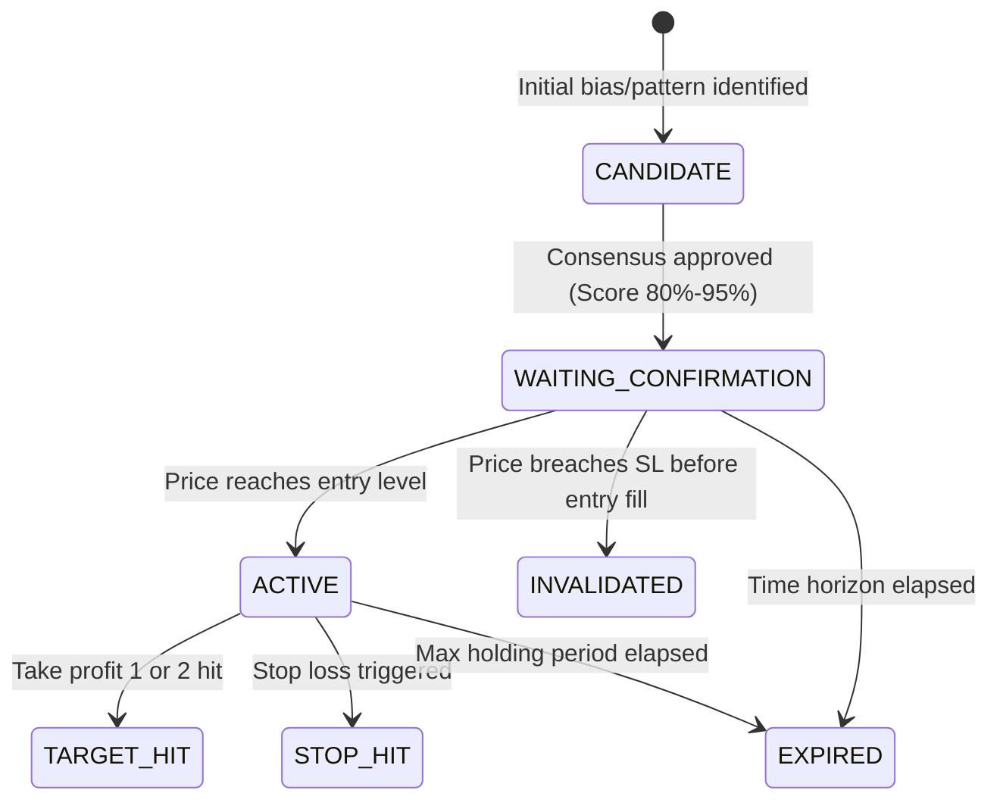

# TAIKRY AI MARKET INTELLIGENCE PRO

## Institutional Multi-Agent Autonomous Financial Intelligence Platform

**Developer:** HENG TAIKRY  
**Primary Market:** XAUUSD (Gold vs US Dollar)  
**Supported Markets:** Commodities (XAUUSD, XAGUSD), Forex Majors/Crosses, Cryptocurrencies  
**Bilingual Support:** ភាសាខ្មែរ (Khmer - Default) & English  
**Architecture:** Python 3.12 | FastAPI REST Backend | SQLite (WAL Mode) | Hybrid AI Model Router | Web Dashboard  

---

## 1. System Architecture Overview

TAIKRY AI MARKET INTELLIGENCE PRO uses registered analysis and orchestration components. The core signal path includes:

1. **Agent 1 — Technical & Momentum Analyst (`technical_analyst`):**  
   Multi-timeframe EMAs (20, 50, 200), Wilder's RSI (14), ATR volatility bands, and non-repainting causal swing fractals.
2. **Agent 2 — ICT / SMC Institutional Structure Analyst (`ict_smc_analyst`):**  
   Break of Structure (BOS), Change of Character (CHoCH), Fair Value Gaps (FVG with mitigation tracking), Order Blocks (OB with body/wick bounds), and Liquidity Sweeps (BSL/SSL).
3. **Agent 3 — Macro Catalyst & Currency Regime Analyst (`macro_analyst`):**  
   Available DXY context, economic calendar events, and macro news. Yield data is not currently loaded by this component; missing feeds remain unavailable.
4. **Agent 4 — Independent Risk Validator & Gatekeeper (`risk_validator`):**  
   Server-side risk controls use the configured risk percentage (default 0.5%, maximum 2%), configured minimum R:R (default 1:2.0), maximum simultaneous positions, and economic-calendar availability checks. Analysis fails closed when required data or risk checks are unavailable.
5. **Multi-Agent Consensus Engine (`consensus_engine`):**  
   Combines the available agent outputs, preserves dissent, applies risk checks, and generates Khmer and English reports. Participation is checked against the eligible agents discovered for the request.
6. **Round-Table Adversarial Debate Engine (`debate_engine`):**  
   Organizes analysis and dissent summaries. A generated debate summary should not be interpreted as proof that independent model calls occurred unless the response identifies those calls.
7. **Continuous Self-Trainer & Recalibration Engine (`self_trainer`):**  
   Tracks resolved directional outcomes and Brier scores, and updates weights only when eligible resolved outcome data is available.

---

## 2. Signal Lifecycle State Machine

Signals are treated as persistent, stateful entities, NOT disposable text alerts:



### Invalidation Reporting

When a signal is `INVALIDATED`, the exact structural or macroeconomic cause is recorded in both English and Khmer:

- **English:** `"Market structure invalidated: Price dropped to 4030.00 breaching Stop Loss level 4035.00 prior to entry fill."`
- **ភាសាខ្មែរ:** `"រចនាសម្ព័ន្ធទីផ្សារត្រូវបានរំលោភ៖ តម្លៃបានធ្លាក់ចុះដល់ 4030.00 បំពានចំណុចទប់ស្កាត់ខាត 4035.00 មុនពេលចូលជួញដូរ។"`

---

## 3. Hybrid AI Model Routing & Circuit Breaker

The system routes requests across multiple AI providers with automatic fallback:

1. **Groq Cloud:** Free DeepSeek R1 & Llama 3.3 at ultra-high speed (500 tok/s).
2. **Google Gemini:** Gemini 2.5 Flash / Pro.
3. **DeepSeek:** DeepSeek R1 Reasoner / V3.
4. **Anthropic Claude:** Claude 3.7 Sonnet / 3.5 Sonnet.
5. **OpenAI:** o3-mini / GPT-4o.
6. **Manus AI:** Autonomous Agent API.
7. **Deterministic Python agents:** Technical, ICT/SMC, macro, and risk agents run locally in the application process. They are code-based analysts, not separate cloud LLM sessions; their actionable output still depends on fresh provider data. Optional cloud LLM synthesis runs only when selected and configured.

Every model call records full provenance metadata (`model_used`, `provider_used`, `fallback_occurred`, `latency_ms`). Circuit breakers automatically trip after consecutive errors and cool down for 60 seconds.

---

## 4. Institutional XAUUSD Multi-Timeframe Matrix

Analyzes Gold (XAUUSD) hierarchically:

- **D1 (Daily):** Major trend, 200 EMA, macro dealing range, daily bias.
- **H4 (4-Hour):** Market structure, institutional order blocks, supply/demand zones.
- **H1 (1-Hour):** Intermediate trend, BOS/CHoCH, Fair Value Gaps (FVG).
- **M15 (15-Minute):** Setup confirmation, liquidity sweeps, entry refinement.
- **M5 (5-Minute):** Refined precision trigger and tight invalidation level.

### Session Windows

- **Asian Range (00:00 - 08:00 UTC):** Liquidity accumulation.
- **London Session (08:00 - 16:00 UTC):** Liquidity sweep of Asian range.
- **New York Session (13:00 - 21:00 UTC):** Institutional momentum & macro reaction.
- **London/NY Overlap (13:00 - 16:00 UTC):** Maximum institutional volume & volatility window.

---

## 5. CLI Launcher Commands

All operations can be initiated from the command line using `main.py`:

```bash
# 1. Start FastAPI REST backend & Web Dashboard (http://localhost:8000/dashboard)
python main.py --server

# 2. Start continuous 24/7 autonomous monitoring loop
python main.py --monitor

# 3. Execute a single multi-agent scan across the watchlist
python main.py --scan

# 4. Scan a specific instrument (e.g., Gold or Bitcoin)
python main.py --scan --symbol XAUUSD
python main.py --scan --symbol BTCUSDT

# 5. Generate bilingual report and dispatch to the configured Telegram chat and Make webhook
python main.py --send-report --symbol XAUUSD

# 6. Run walk-forward backtest on historical candles
python main.py --backtest --symbol XAUUSD
```

---

## 6. Key REST API Endpoints

| Method | Endpoint | Description |
| :--- | :--- | :--- |
| `GET` | `/health` | System health audit across feeds, DB, LLMs |
| `GET` | `/api/v1/agents/registry` | All registered agents, metadata, status |
| `GET` | `/api/v1/agents/registry/summary` | Agent telemetry, latency metrics, fallback rules |
| `POST` | `/api/v1/agents/registry/{id}/configure` | Dynamic agent configuration (Admin key required) |
| `GET` | `/api/v1/router/policy` | Hybrid AI router policy, cascades, circuit breakers |
| `POST` | `/api/v1/router/policy` | Update model routing priority and thresholds |
| `GET` | `/api/v1/signals/lifecycle` | Filter signals by state (`CANDIDATE`, `ACTIVE`, etc.) |
| `GET` | `/api/v1/signals/{id}` | Full transition history & bilingual invalidation reason |
| `POST` | `/api/v1/signals/{id}/transition` | Manually/algorithmically transition signal state |
| `GET` | `/api/v1/xauusd/multi-timeframe` | 5-timeframe hierarchy analysis (D1, H4, H1, M15, M5) |
| `GET` | `/api/v1/xauusd/chart` | OHLCV candles, causal indicators, FVG, OB, BOS, sweeps |
| `GET` | `/api/v1/best-setup` | Single highest scoring setup across watchlist (80%-95%) |
| `POST` | `/api/v1/telegram/broadcast-alert` | Dispatch verified #1 best setup to Telegram |
| `GET` | `/api/v1/agents/debate` | Structured summary of registered agent findings in EN & KH; not proof of independent LLM calls |
| `POST` | `/api/v1/agents/train` | Trigger self-training epoch |
| `GET` | `/api/v1/agents/learning-stats` | Brier scores, accuracy, and dynamic voting weights |
| `GET` | `/api/v1/system/auto-fix/alerts` | Autonomous self-healing incident audit trail |
| `POST` | `/api/v1/trade/execute-bridge` | Simulated paper-trade ticket using configured risk limits; does not send broker orders |
| `GET` | `/api/v1/chart/indicators` | Indicator catalogue with parameter schemas & bilingual metadata |
| `POST` | `/api/v1/chart/indicators/calculate` | Dynamic quantitative indicator calculation on candle history |
| `GET` | `/api/v1/chart/overlays` | Active ICT/SMC structure overlays, MTF bias, and trade signals |

---

## 7. Professional Financial Chart Workspace

Taikry Signal AI includes an institutional-grade, interactive financial chart workspace:

### 7.1 Architecture & Library

- **Library**: TradingView Lightweight Charts (v4.2.1 Offline Vendored in `taikry/web/lightweight-charts.standalone.production.js`) with custom SVG/Canvas overlay layer.
- **Dual-Mode Engine Switcher**: Seamless toggle between "⚡ Taikry Native Pro Terminal" (interactive with SMC/AI overlays) and "🌐 TradingView Cloud Embed" (standard TradingView widget).
- **Timeframes**: M1, M5, M15, M30, H1, H4, D1, W1.
- **Series Types**: Candlestick, OHLC Bar, Line, Area.

### 7.2 Indicator Suite

- **Trend Following**: EMA 9, 20, 50, 100, 200; SMA 20, 50, 200; Multi-timeframe trend alignment.
- **Momentum**: Wilder's RSI 14 (with 70/30/50 levels), MACD (12, 26, 9), Fast & Slow Stochastic Oscillator (%K 14, %D 3).
- **Volatility**: ATR 14, Bollinger Bands (20, 2.0), Keltner Channels (20, 1.5 ATR).
- **Volume & Price Benchmarks**: Session-Anchored VWAP, Volume Histogram, Daily Open (DO), Previous Day High/Low (PDH/PDL), Previous Week High/Low (PWH/PWL), Floor Pivots (Pivot, R1, S1, R2, S2).

### 7.3 Smart Money Concepts (ICT/SMC) Overlays

- **BOS (Break of Structure)**: Trend continuation breaks with confirmed candle close past swing levels.
- **CHoCH (Change of Character)**: First structural break against prevailing trend indicating trend reversal.
- **FVG (Fair Value Gaps)**: 3-candle imbalance zones with Consequent Encroachment (CE 50%) and real-time mitigation tracking.
- **Order Blocks (OB)**: Institutional down/up-close candles preceding sharp impulsive displacement.
- **Liquidity Sweeps**: Buy-side (BSL) and Sell-side (SSL) liquidity traps with wick probe and rejection close.
- **Trade Signal Markers**: Dynamic entry line, stop loss line, take profit lines, and risk-to-reward ratio box.

### 7.4 Interactive Vector Drawing Tools

- Cursor, Trendline, Horizontal Ray, Fibonacci Retracement (0.618, 0.705 OTE, 0.786), Measure Ruler, Clear All.

---

## 8. Quality Assurance & Verification

Automated tests live under `tests/`; their count and coverage evolve with the code. Review the current tests and deployment configuration before relying on a specific guarantee. Run the suite in a suitable local environment before deployment:

```bash
pytest -q
```

---

## 9. Operational Security Note

- Never commit private keys, bot tokens, or webhook credentials into source control.
- All external API secrets must be loaded via `.env` or system environment variables.
- Server-side risk validation applies configured limits and fails closed when required market or risk inputs are unavailable. Check the provider, spread, calendar, and position-count integrations before relying on generated analysis.
- Telegram bot tokens are automatically masked (`[REDACTED_BOT_TOKEN]`) in all logs, error paths, and API responses.

---

## 10. XAUUSD Telegram Signal Engine & Win-Rate Tracking

The dedicated XAUUSD Signal Engine provides institutional-grade Gold trade signal generation, atomic quota enforcement, real-time lifecycle tracking, and verified performance calculation.

### 10.1 Core Policies & Constraints

1. **Strict XAUUSD-Only Pipeline:**
   Trading signals dispatched to Telegram are restricted exclusively to XAUUSD. Non-Gold assets (BTCUSD, EURUSD, etc.) are strictly blocked from Telegram delivery while remaining accessible on the internal web dashboard and paper trading desk. Symbol aliases (`GOLD`, `XAU/USD`, `OANDA:XAUUSD`) are normalized to canonical `XAUUSD`.

2. **Atomic Daily Quota (Asia/Phnom_Penh):**
   - **Target:** 2–4 high-quality signals per Cambodia calendar day.
   - **Hard Cap:** Exactly 4 new signals per day. Never exceeded.
   - **Persistence:** Signal delivery reservations and states are stored in the configured database. A process-local lock reduces duplicate sends within one worker; it does not coordinate multiple app replicas. Use a shared production database and add a database-level reservation/unique constraint before running multiple workers if a strict global daily cap is required.
   - **Zero Forcing:** Zero signals are sent when market conditions, spread, volatility, or AI consensus are unfavorable.

3. **All-Agent Dynamic Discovery & Consensus:**
   - Discovers all enabled, healthy agents dynamically from `AgentRegistry`.
   - Requires $\ge 60\%$ eligible-agent participation.
   - Conflicting biases (Bullish vs Bearish) trigger an immediate `WAIT` decision.
   - Uses a measured setup-confluence score (not a win probability), a score gate of 80–95, and the configured minimum R:R (default 2.0).

4. **Reliable Telegram Delivery:**
   - Dispatched only to the chat configured through `TELEGRAM_CHAT_ID`, using bilingual templates (Khmer-first with English technical details).
   - Verifies HTTP 200 and `{"ok": true}` from Telegram Bot API before updating status to `SENT`.
   - Records Telegram `message_id` and dispatches via transactional idempotency key.
   - Retries with exponential backoff on network failures; masks bot token on error.

5. **Independent Outcome Resolution (`TP1_CONSERVATIVE_V1`):**
   - Evaluates tick and candle price action against entry, SL, and TP targets.
   - **TP1 Win:** Price hits TP1 after valid entry fill before hitting Stop Loss.
   - **SL Loss:** Price hits Stop Loss before reaching TP1.
   - **Same-Candle Ambiguity:** If both High $\ge$ TP1 and Low $\le$ SL in the same bar without provable sequence, the outcome is marked `AMBIGUOUS` and conservatively excluded from wins.
   - **Exclusion Rule:** Expired without entry, cancelled, open, and ambiguous signals are excluded from the win-rate denominator.

6. **Verified Win-Rate Formula:**
   $$\text{Win Rate} = \frac{\text{Wins}}{\text{Wins} + \text{Losses}} \times 100\%$$
   - Always displayed with explicit sample size: `${wins}W / ${losses}L (${sampleSize} res)`.
   - When resolved trades $= 0$, displays `"N/A — insufficient resolved trades"` (never misleading 0% or 100%).
   - Metrics tracked separately for All-Time, Today, Last 7 Days, Last 30 Days, BUY, SELL, TP2/TP3 attainment, and R-multiples.

### 10.2 REST API Endpoints

| Method | Endpoint | Description |
| --- | --- | --- |
| `GET` | `/api/v1/xauusd/signals` | List persistent XAUUSD signals with status, direction, date, and outcome filters |
| `GET` | `/api/v1/xauusd/signals/{signal_id}` | Detailed signal lifecycle view with agent opinions and audit history |
| `GET` | `/api/v1/xauusd/signals/stats` | Verified win-rate statistics, sample sizes, and R-multiple analytics |
| `GET` | `/api/v1/xauusd/signals/daily-quota` | Current Cambodia date quota status and remaining signal allowance |
| `POST` | `/api/v1/xauusd/signals/generate` | Trigger on-demand multi-agent analysis and optional Telegram dispatch |
| `GET` | `/api/v1/xauusd/signals/daily-report/preview` | Preview daily performance briefing before dispatch |
| `POST` | `/api/v1/xauusd/signals/daily-report/dispatch` | Dispatch idempotent scheduled daily report to Telegram |
| `POST` | `/api/v1/xauusd/signals/admin/config` | Admin endpoint to adjust daily quota (clamped to $\le 4$) and scoring |

### 10.3 CLI Commands

```bash
# 1. Inspect live daily quota and verified performance stats
python main.py --stats

# 2. Preview or dispatch scheduled daily Telegram report
python main.py --daily-report
```
