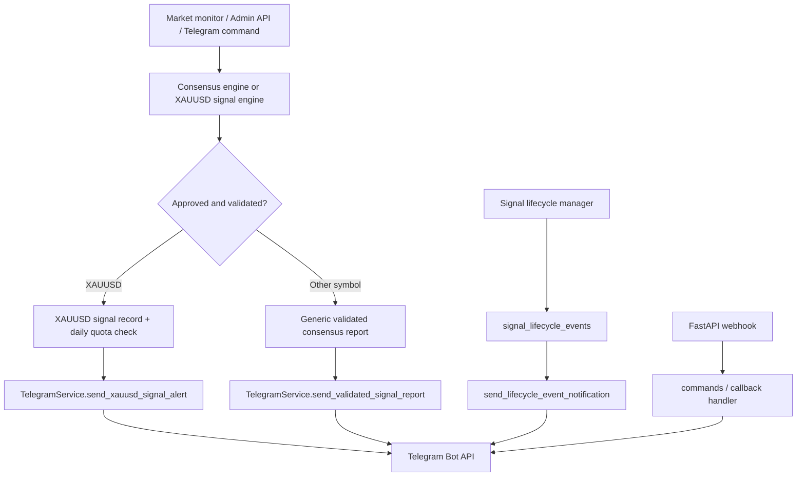

# Telegram Signal System Audit

**ស្ថានភាព៖ Audit មូលដ្ឋាន និង implementation ក្នុង workspace បានធ្វើរួច; test/deploy នៅរង់ចាំ**
**កាលបរិច្ឆេទ៖ 2026-10-31**

ផ្នែក “ផែនទីស្ថាបត្យកម្ម”, “លំហូរផ្ញើសញ្ញា”, “Root causes” និង “ផែនការ” ខាងក្រោមជារូបភាពមូលដ្ឋានមុន implementation។ បន្ទាប់ពីអ្នកស្នើឱ្យបន្ត កូដ/model/migration/config និង Telegram media ត្រូវបានកែប្រែក្នុង workspace នេះ។ មិនបានអាន `.env` ឬបង្ហាញ credentials ទេ។ មិនបាន deploy ទៅ Render ទេ។

## សេចក្តីសង្ខេប

ប្រព័ន្ធមានមូលដ្ឋានប្រើបានរួច៖ FastAPI ទាក់ទង Telegram Bot API តាម HTTPS, មាន webhook secret, ការផ្ទៀងផ្ទាត់ admin, PostgreSQL models សម្រាប់ XAUUSD signals និង lifecycle events, និងការការពារស្ទួនដែលមាន idempotency សម្រាប់ lifecycle events។

ប៉ុន្តែការផ្ញើសញ្ញាទូទៅនៅតែមានផ្លូវច្រើន និងមិនប្រើ persistent deduplication រួមគ្នា។ មាន fallback ក្នុង `send_bilingual_report()` ដែលអាចបង្កើតទិសដៅ BUY/SELL និង SL/TP ពីតម្លៃគណនាពេលព័ត៌មានមិនគ្រប់ ហើយ `force=True` រំលង score gate និង dedupe ក្នុង memory។ វាផ្ទុយនឹងគោលការណ៍ «មិនបង្កើតសញ្ញាក្លែង»។ ការកំណត់ quota XAUUSD ពិនិត្យចំនួនមុនបង្កើត record ប៉ុន្តែមិនមែនជាការកក់ quota atomic ឆ្លង process ទេ។

## ផែនទីស្ថាបត្យកម្មបច្ចុប្បន្ន

## ឯកសារសំខាន់ៗដែលបានរកឃើញ

| ផ្នែក | ឯកសារ | តួនាទី |
|---|---|---|
| Telegram service | `taikry/notifications/telegram_service.py` | Direct Bot API calls, send/edit message, commands, callbacks, keyboard, XAUUSD delivery, lifecycle notification, delivery audit។ |
| Monitor | `taikry/monitoring/engine.py` | Scan loop, cooldown ក្នុង process, បង្កើត general lifecycle/paper trade និងចែកសញ្ញាទៅ Telegram។ |
| XAUUSD signal generation | `taikry/trading/xauusd_signal_engine.py` | ពិនិត្យ source/freshness, agents, risk, daily count, duplicate setup និងរក្សា XAUUSD signal។ |
| Lifecycle | `taikry/trading/lifecycle.py` | រក្សា state transition និងបង្កើត lifecycle event សម្រាប់ dispatch។ |
| Database models | `taikry/database/models.py` | `NotificationAudit`, `SignalLifecycleModel`, `SignalLifecycleEventModel`, `XAUUSDTelegramSignalModel`, `XAUUSDDailyReportRecord`, Telegram links/preferences។ |
| DB startup/migration | `taikry/database/session.py`, `taikry/database/migrate_lifecycle_events.py` | `create_all` និង migration scripts; `init_db()` ត្រូវបានហៅនៅពេល import និង FastAPI startup។ |
| API webhook/send routes | `taikry/api/routes.py` | Webhook, status, admin test signal, broadcast alert, XAUUSD generate, test notification។ |
| SaaS Telegram linking | `taikry/api/saas_routes.py` | Authenticated Telegram linking/preferences និង webhook ដោះស្រាយ deep-link token។ |
| VIP bot | `taikry/subscriptions/vip_manager.py` | សារ subscription, invite links និងសារ VIP ទៅអ្នកប្រើ។ |
| Entrypoints | `taikry/api/app.py`, `main.py`, `engine_247.py` | FastAPI startup, compatibility/manual run, និង legacy signal/report calls។ |
| Hosting | `Dockerfile`, `Procfile`, `render.yaml` | Docker ចាប់ FastAPI; Procfile កំណត់ web/worker; Render manifest បច្ចុប្បន្នមាន web service មួយ។ |
| Config | `taikry/config.py`, `.env.example` | Bot token/chat/admin/webhook, lifecycle flag, និង daily XAUUSD cap។ |

Telegram call sites ដែលបានរកឃើញក្រៅ service៖ `main.py`, `taikry/api/routes.py`, `taikry/api/saas_routes.py`, `taikry/monitoring/engine.py`, `taikry/trading/lifecycle.py`, និង `taikry/subscriptions/vip_manager.py`។

## លំហូរផ្ញើសញ្ញា

1. **Monitor** (`taikry/monitoring/engine.py`) រក setup ដែលមាន `APPROVE`, ទិសដៅត្រឹមត្រូវ, score 80–95 និង Entry/SL/TP ត្រឹមត្រូវ។ Cooldown ត្រូវបានរក្សាក្នុង `cooldown_tracker` របស់ process។
2. សម្រាប់ **XAUUSD**, monitor ហៅ `xauusd_signal_engine.generate_xauusd_signal()`។ Engine កំណត់ XAUUSD តែប៉ុណ្ណោះ, ពិនិត្យ market/source/quote, agents និង risk, បន្ទាប់មកកត់ត្រា `XAUUSDTelegramSignalModel` ជា `PENDING` មុន Telegram send។
3. `send_xauusd_signal_alert()` ផ្ញើ `sendMessage`, រក្សា status និង message ID ហើយ retry រហូត 2 ដងក្រោយ exception/response failure។
4. សម្រាប់ **Forex/crypto ផ្សេងទៀត**, monitor ប្រើ `send_validated_signal_report()`។ វាផ្ញើសារដែលបាន format តែប៉ុណ្ណោះ ប៉ុន្តែ send ត្រឡប់ bool និង dedupe មិនមានក្នុង database។
5. Lifecycle (`TP/SL/expired/closed`) បង្កើត `SignalLifecycleEventModel` មាន idempotency key ហើយ dispatcher ប្រើ database conditional claim។ Feature នេះត្រូវបានបិទតាម default ដោយ `TELEGRAM_SEND_LIFECYCLE_EVENTS=false`។ Timeout រក្សា `UNCERTAIN_TIMEOUT` ហើយមិន retry ដោយស្វ័យប្រវត្តិ។
6. Admin APIs និង Telegram commands/callbacks ក៏អាចបង្កើត scan ឬសារដាច់ដោយឡែកបាន។

## Database និង persistence ដែលមានរួច

- `notification_audits`: ប្រភេទ channel/event, payload summary, status, response code, error និង timestamp។ វាមិនមែនជាកន្លែងកក់/dispatch notification ហើយ `send_message()` មិនរក្សា Telegram message ID ទេ។
- `signal_lifecycles`: general signal state, price levels, state history និង message ID មួយ។
- `signal_lifecycle_events`: unique `idempotency_key`, claim/status, retry count, chat/message ID និង timestamps។ នេះជាការការពារដែលរឹងមាំជាង generic sender។
- `xauusd_telegram_signals`: XAUUSD-specific setup, broker, levels, status, outcome, chat/message ID, daily Cambodia date និង unique idempotency key។
- `xauusd_daily_reports`: unique date/idempotency key សម្រាប់ daily report។
- `telegram_links` និង `notification_preferences`: account linking និង preference របស់អ្នកប្រើ។
- មិនបានរកឃើញ **unified Telegram notification outbox** ដែលគ្រប់ signal type ចែករំលែកទេ។ មាន general lifecycle table និង XAUUSD Telegram table ដែលដំណើរការដាច់ពីគ្នា។

## អ្វីដែលមានស្រាប់ និងត្រូវរក្សា

- XAUUSD engine ទទួលតែ XAUUSD; ពិនិត្យ quote source `EXNESS_MT5` ឬ `OANDA_V20`, bid/ask, freshness និង risk/level ordering មុនរក្សា setup។
- XAUUSD signal record មាន `SHADOW_PAPER` default និង broker/source fields។ គោលការណ៍ live-trading disabled ត្រូវរក្សាដដែល។
- តម្លៃ score XAUUSD ត្រូវកំណត់ក្នុងចន្លោះ 80–95 ហើយបង្ហាញថាជា setup score មិនមែន win probability។
- Lifecycle events មាន idempotency key unique, atomic conditional claim និងគោលការណ៍មិន blind-resend ក្រោយ timeout។
- Webhook routes ផ្ទៀងផ្ទាត់ `X-Telegram-Bot-Api-Secret-Token` ដោយ `hmac.compare_digest`; API admin actions ដែលបានពិនិត្យប្រើ `require_admin_access`; Telegram linking ប្រើ single-use token មានកំណត់ពេល។
- Tests មានគ្របដណ្តប់ duplicate lifecycle, concurrent claim, uncertain timeout, XAUUSD cap, retry និង webhook/callback behavior។ Tests ទាំងនេះមិនត្រូវបានរត់នៅ Phase 0។

## Root causes និងហានិភ័យ

| កម្រិត | ចំណុច | ផលប៉ះពាល់ |
|---|---|---|
| ខ្ពស់ | `send_bilingual_report()` មាន fallback បង្កើត BUY/SELL, SL/TP ពី ATR ឬចំនួនគណនាបើ plan មិនពេញ; score អាចក្លាយជា 88។ `force=True` រំលង threshold និង memory dedupe។ | អាចបញ្ជូន signal ដែលមិនបានបញ្ជាក់ដោយ analysis ពេញលេញ។ `broadcast_signal_alert()` និង test signal route ប្រើ `force=True`; ត្រូវធ្វើឱ្យ validation ជាច្រកតែមួយ។ |
| ខ្ពស់ | Generic sender មិនមាន DB idempotency។ `LAST_SENT_ALERTS` ជា process memory; `send_validated_signal_report()` មិនឆែក duplicate មុនផ្ញើ; approval statuses ក៏មិនត្រូវបានបិទជាមួយ reliable key។ | Restart/worker ផ្សេង ឬការហៅម្តងទៀតអាចបញ្ជូនសារស្ទួន។ |
| ខ្ពស់ | XAUUSD daily quota ប្រើ count → analyze → insert ជាច្រើនជំហាន។ `_generation_lock` ការពារតែក្នុង process មួយ។ | Request ព្រមគ្នាឆ្លង process/instance អាចឆ្លង quota check មុនពេល record ត្រូវបាន insert។ Database unique key ការពារតែ key ដូចគ្នា មិនមែន quota atomic ទាំងមូល។ |
| ខ្ពស់ | XAUUSD send retry ក្រោយ exception រួមទាំង network timeout។ | Telegram អាចទទួល message រួច តែ response បាត់; resend អាចបង្កើត duplicate។ Lifecycle sender ដោះស្រាយ timeout ប្រយ័ត្នជាងនេះ។ |
| មធ្យម | `send_message()` ត្រឡប់តែ bool និង audit error/exception មិន mask token ទាំងអស់; `send_text()` និង XAU/lifecycle send មានលទ្ធផល និង message ID ល្អជាង។ | Generic flow មិនអាចកែសារដើម ឬភ្ជាប់ delivery ជាក់លាក់ទៅ signal បាន; exception/URL អាចបង្ហាញ token ក្នុង log/audit ប្រសិនបើកំហុសមាន URL។ |
| មធ្យម | XAUUSD signal, general lifecycle signal, monitor cooldown និង generic Telegram report មាន persistence/identity ខុសគ្នា។ Manual/admin send អាចចៀសផ្លូវ monitor។ | ស្ថានភាព dashboard និង Telegram អាចមិនត្រូវគ្នា ហើយគ្មាន dispatcher តែមួយទទួលខុសត្រូវលើ dedupe។ |
| មធ្យម | Analysis progress message មិនភ្ជាប់ទៅ backend agent execution run។ `edit_message_text()` មានសម្រាប់ command/callback/lifecycle ប៉ុន្តែមិនមាន persisted progress message ID សម្រាប់ analysis run។ | មិនអាចបង្ហាញ progress ពិតជាបន្តលើសារតែមួយបានទេ; lifecycle notification ក៏បិទតាម default។ |
| មធ្យម | `AUTO_START_MONITORING=true` ចាប់ monitor thread ក្នុង FastAPI lifespan។ Render manifest មានតែ web service; `Dockerfile` បើក uvicorn។ `Procfile` មាន worker command ប៉ុន្តែមិនបានភ្ជាប់ជា Render worker ក្នុង manifest។ | បច្ចុប្បន្ន Render កំណត់ `numInstances: 1`; បើ scale web ឡើង ឬបន្ថែម worker ដោយមិនបិទ in-web monitor នឹងមាន scan loops ច្រើន។ |
| មធ្យម | Render `envVars` មិនមាន `TELEGRAM_BOT_TOKEN`, `TELEGRAM_CHAT_ID`, `TELEGRAM_ADMIN_IDS`, `TELEGRAM_WEBHOOK_SECRET` ឬ lifecycle flag។ `.env.example` មាន placeholders សម្រាប់ local config ប៉ុណ្ណោះ។ | Deployment Telegram ពឹងលើការកំណត់ដោយដៃនៅ Render Dashboard; repo manifest មិនប្រាប់ពីភាពខ្វះនោះ។ មិនបានពិនិត្យតម្លៃ secret ពិតក្នុង Render។ |
| មធ្យម | មិនបានរកឃើញ Telegram SDK, `sendPhoto`, `sendAnimation`, sticker/media sender ឬ media asset/file_id table។ | Branded animation/sticker pipeline ពី prompt មិនទាន់មាន។ |
| ទាប/ត្រូវតាមដាន | `NotificationAudit` error ត្រូវបានរក្សាទុក និង audit DB failure ត្រូវបានបិទស្ងាត់ (`except: pass`); migration lifecycle ក៏សម្អាត state signal ចាស់នៅ startup។ | Observability អាចបាត់ដោយមិនឲ្យ caller ដឹង; schema startup path មាន side effect លើ signal state ដូច្នេះការប្តូរ migration ត្រូវអនុវត្តដោយ review និង backup។ |
| ទាប/ត្រូវតាមដាន | មិនបានរកឃើញ app-level rate limit សម្រាប់ scan/callback command នៅក្នុង Telegram service។ | អាចបង្កើន workload/API calls ប្រសិនបើប្រើ command ញឹកញាប់; គួរបន្ថែម limit នៅជំហាន hardening។ |

### Failure និង retry បច្ចុប្បន្ន

- Generic `send_message()` timeout 8 វិនាទី, return `False`, គ្មាន retry និងគ្មាន `message_id`។
- `send_text()` timeout 8 វិនាទី, ត្រឡប់ `success/message_id/error` និង mask bot token ពី exception string។
- XAUUSD signal sender retry 3 ដងសរុប; timeout មិនត្រូវបានបំបែកជា delivery-uncertain ដូច lifecycle path ទេ។
- Lifecycle sender retry តែមួយដងសម្រាប់ failure ដែលច្បាស់; timeout ត្រូវបានកត់ជា `UNCERTAIN_TIMEOUT` ហើយ suppress resend។
- Audit persistence មិនធ្វើឱ្យ send បរាជ័យទេ ព្រោះ DB audit errors ត្រូវបានស្រូប។

## បណ្ណាល័យ Telegram និង Media

`requirements.txt` មាន `requests` ហើយមិនមាន `python-telegram-bot` ឬ SDK ផ្សេងដែលរកឃើញ។ Service បង្កើត Telegram Bot API URLs ដោយផ្ទាល់។ Search បានរកឃើញ `sendMessage`, `editMessageText`, callback, invite/member APIs ប៉ុន្តែមិនបានរកឃើញការផ្ញើ media/sticker ឬការកំណត់ file_id cache។

## ផែនការអនុវត្តជាក់លាក់ (ក្រោយពិនិត្យ audit)

### Phase 1 — សុវត្ថិភាព signal និង data contract

1. កំណត់ `ValidatedSignal` contract តែមួយសម្រាប់ XAUUSD/Forex/crypto៖ instrument, direction, entry/zone, SL, TP, score ដែលមានប្រភព, market provider, price timestamp, freshness, timeframe, signal ID និង invalidation។
2. ដក fallback ដែលបង្កើត direction/score/SL/TP ក្នុង `send_bilingual_report()` ចេញពី automatic path។ ខ្វះ field ណាមួយ ឬមិន `APPROVE` គឺ suppress signal; test notification ប្រើសារសាកល្បងច្បាស់ មិនប្រើ trade levels ក្លែង។
3. ឱ្យ manual/admin endpoint ហៅ validation និង dispatcher ដូច monitor; `force` មិនអាចរំលង risk, freshness, dedupe ឬ quota បាន។

### Phase 2 — Persistent notification outbox និង dedupe រួម

1. Design migration ដែលបន្ថែម notification/outbox record (ឬពង្រីក model ដែលសមស្រប) ដោយមាន `signal_id`, `notification_type`, `event_state`, chat, idempotency key, status, attempts, timestamps, message ID និង safe error។
2. កំណត់ unique identity តាម signal + event/type + target chat ដើម្បីឲ្យ generic, XAUUSD, lifecycle និង manual path មាន dedupe ដូចគ្នា។ Preserve existing XAU/lifecycle rows; មិនលុប ឬបម្លែង data ដោយស្ងាត់។
3. Claim ដោយ transaction/conditional update ក្នុង PostgreSQL; កំណត់ expiration/recovery សម្រាប់ claim ដែល worker ឈប់មុន dispatch។ សម្រាប់ timeout ប្រើ `UNCERTAIN` ដោយមិន blind resend។
4. កំណត់ response contract របស់ Telegram client ឲ្យជាប់លាប់៖ success, `message_id`, HTTP/API status និង redacted error។ រក្សា IDs មុនសម្គាល់ delivered។

### Phase 3 — Daily quota និង setup fingerprint atomic

1. ប្រើ transaction/DB lock ឬ quota row ក្នុងថ្ងៃ timezone ដែលកំណត់ជា `Asia/Phnom_Penh` ដើម្បី reserve quota atomically មុនការផ្ញើ XAUUSD signal។ Update/retry មិនរាប់ជាសញ្ញាថ្មី។
2. បន្ថែម setup fingerprint មាន window/expiry ដែលកំណត់ច្បាស់ (symbol, direction, entry band, SL/strategy/timeframe) និង unique constraint ដើម្បីកុំទប់ស្កាត់ setup ថ្មីជារៀងរហូត។
3. ពិនិត្យ race condition និង error handling នៅពេល unique conflict ឲ្យត្រឡប់ duplicate result មិនបង្ហាញ DB error ទៅអ្នកប្រើ។

### Phase 4 — Progress message ពិត និង controlled updates

1. សម្រាប់ on-demand/deep analysis ដែលអ្នកប្រើស្នើ ឬ opt-in ប៉ុណ្ណោះ បង្កើត progress message មួយ និងរក្សា `analysis_run_id`, chat ID, message ID, event status។ Background scan ធម្មតាមិនផ្ញើ “analyzing” ជាច្រើនសារទៅ channel ទេ។
2. ផ្គូផ្គង status ពី execution result ពិត៖ `QUEUED/RUNNING/COMPLETED/FAILED/SKIPPED/TIMEOUT`; មិនបង្កើត percentage ឬបង្ហាញ COMPLETE មុន agent បញ្ចប់។
3. កែសារដើមសម្រាប់ progress; កត់ edit failure និងធ្វើ fallback តែមួយដងតាម policy ដើម្បីមិន spam។
4. ភ្ជាប់ TP/SL/invalidation ទៅ existing lifecycle event model, កំណត់ allowed transitions និង dedupe event មួយដង។ បើបើក lifecycle Telegram flag ត្រូវមាន test/rollout policy មុន production។

### Phase 5 — Worker topology និង configuration

1. ជ្រើស owner តែមួយសម្រាប់ market monitoring នៅ Render៖ បង្កើត worker service ពី `python engine_247.py --interval 30` ហើយកំណត់ `AUTO_START_MONITORING=false` លើ web service, ឬរក្សា in-web monitor ប៉ុន្តែត្រូវមាន database singleton lease និងមិនបើក worker ទៀត។ ជម្រើសដែលបានណែនាំគឺ dedicated worker ដើម្បីឲ្យ API web restart មិនបង្កើត monitor loop ថ្មី។
2. បន្ថែម secret **keys** (មិនបញ្ចូលតម្លៃ secret) ដែលត្រូវការទៅ Render manifest/docs៖ Telegram token, default chat, admin IDs, webhook secret, lifecycle flag និង cap។ កំណត់ secrets តាម Render Dashboard, មិន commit តម្លៃ។
3. Audit migration startup side effects; schema migration គួរតែបំបែកពី data cleanup ហើយមាន backup/rollback plan មុន deploy។

### Phase 6 — Brand media ជាជំហានបន្ទាប់

បន្ទាប់ពី text delivery និង idempotency មានស្ថិរភាព ទើបបន្ថែម media pipeline៖ assets ដែលបាន validate, format ដែល Telegram គាំទ្រ, checksum/version និង Telegram `file_id` cache។ Media upload failure មិនត្រូវរារាំងសារ signal text ហើយមិនត្រូវ upload asset ដដែលរាល់ពេល។

### Phase 7 — Verification និង staged rollout

បន្ថែម/កែ tests សម្រាប់ invalid signal suppression, dedupe concurrent PostgreSQL requests, daily quota race, timeout uncertainty, 429/retry policy, message edit/fallback, access control, lifecycle transitions, preference, និង media cache។ រួចដំណើរការ test suite ជាមួយ DB test isolated; ពិនិត្យ preview/staging ដោយ bot/chat សាកល្បង មុន Render production deploy។ ត្រូវរាយការណ៍លទ្ធផលពិតនីមួយៗ មិនអះអាងថា pass ប្រសិនបើមិនបានរត់។

## លក្ខខណ្ឌទទួលយកសម្រាប់ implementation

- សញ្ញាមិនអាចផ្ញើបានបើមិនមាន approved direction, verified/fresh market data, valid entry/SL/TP, risk approval និង documented score។
- គ្រប់ notification ថ្មីមាន idempotency identity និង message ID/status នៅក្នុង PostgreSQL។
- Concurrent workers មិនអាចឆ្លង daily cap ឬផ្ញើ setup/event ដដែលពីរដងបាន។ Timeout មិន blind-resend។
- Analysis progress កែសារតែមួយដោយយោង actual agent execution; lifecycle updates មិនស្ទួន។
- Render មាន monitor owner តែមួយ និង Telegram secrets ត្រូវបានរក្សាក្នុង environment secret store។
- Existing webhook, account linking, subscriptions និង dashboard lifecycle behavior នៅតែដំណើរការ។

## ស្ថានភាពបច្ចុប្បន្ន

### ការងារដែលបានអនុវត្តក្នុង workspace

- បន្ថែម persistent Telegram notification outbox/idempotency, guarded delivery, retry-after handling និងករណី `UNCERTAIN` ដែលមិន resend ដោយស្វ័យប្រវត្តិ។
- បន្ថែម Telegram analysis run record និងកែ progress message តាម stage/status ពិតពី market data, agents និង risk validation; មិនបង្ហាញ percentage ស្មាន។
- ដក signal fallback ដែលប្រឌិត BUY/SELL និង trade levels ចេញពី automatic route; XAUUSD និង generic Forex/crypto មាន validation និង delivery paths ផ្សេងគ្នាច្បាស់។
- បន្ថែម atomic daily XAUUSD quota reservation, quote provenance fields និង database migration ដែលរក្សា rows ចាស់។
- បន្ត lifecycle monitoring បន្ទាប់ពី TP1 ដើម្បីអាចកត់ TP2/TP3 ដោយមិនអះអាងថា stop ត្រូវបានផ្លាស់ទី ឬ broker order ត្រូវបានដាក់។
- បន្ថែម media registry/file-id cache, validated Telegram stickers និង scanning animation, asset catalog, Render/env examples និង deployment guide។
- បន្ថែម/កែ targeted tests និងគ្រប់គ្រង `TELEGRAM_ENABLED` ឱ្យរារាំង send/edit និង Telegram member/invite operations ផងដែរ។
- ភ្ជាប់ website ABA plans (`free_trial`/`pro`/`premium`) ទៅ signal delivery៖ ត្រូវមាន entitlement សកម្ម, Telegram private chat បានភ្ជាប់, `telegram_alerts_enabled` អនុញ្ញាត និង preference ត្រូវបានបើក។ Signal និង lifecycle updates ត្រូវបានផ្ញើតាម per-chat outbox។
- កែ account alert preferences ឱ្យប្រើ field names ដូច API និងបន្ថែម persistent preference សម្រាប់ macro events។ បន្ថែមស្ថានភាព “Signal delivery ready” ដែលបង្ហាញមូលហេតុពេលគណនីមិនទាន់ទទួលសញ្ញា។

### Verification និង rollout

- `git diff --check` បានដំណើរការ៖ មិនបានបង្ហាញ whitespace errors; មានតែ Git warnings អំពីការបម្លែង LF ទៅ CRLF នៅពេល Git សរសេរ files។
- មិនអាចដំណើរការ pytest បានក្នុង environment នេះ ព្រោះ Python launcher និង virtualenv សំដៅទៅ Python ដែលមិនមាន/មិនបានដំឡើង។ Docker CLI ក៏មិនអាចជំនួសបាន ព្រោះ Docker daemon មិនដំណើរការ។ ដូច្នេះ test cases ថ្មីៗមិនត្រូវបានបញ្ជាក់ថា pass ទេ។
- ការដាក់ដំណើរការនៅ Render និងការផ្ទៀងផ្ទាត់តាម Telegram bot/chat មិនទាន់ធ្វើ។ ត្រូវរត់ test suite តាម `TELEGRAM_DEPLOYMENT.md`, បញ្ចូល Telegram secrets ក្នុង Render Environment, ពិនិត្យ `/ping` និងសាក private chat មុនពេល production rollout។

ឯកសារនេះកត់ស្ថានភាព implementation ក្នុង local workspace ប៉ុណ្ណោះ; មិនមែនជាការអះអាងថា production បាន deploy ឬ test suite បាន pass ទេ។
